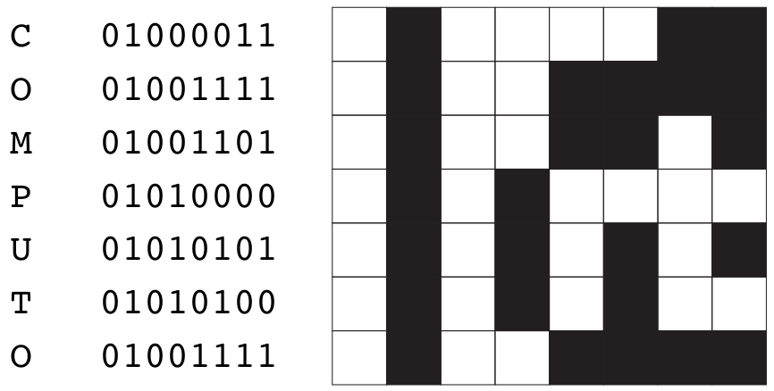

---

## Aims and scientific scope

Computo has been created in the context of a reproducibility crisis in
science, which calls for higher standards in the publication of
scientific results. Computo aims at promoting
computational/algorithmic contributions in statistics and machine
learning (ML) that provide insight into which models or methods are the
most appropriate to address a specific scientific question.

The journal welcomes the following types of contributions:

- New **methods** with original stats/ML developments, or numerical
  studies that illustrate theoretical results in stats/ML;
- **Case studies** or **surveys** on stats/ML methods to address a specific
  (type of) question in data analysis, neutral comparison studies that
  provide insight into when, how, and why the compared methods perform
  well or less well;
- **Software/tutorial papers** to present implementations of stats/ML algorithms or
  to feature the use of a package/toolbox. For such papers we expect not only the description of an existing implementation but also the study of a concrete use case. If applicable, a comparison to related works and appropriate benchmarking are also expected. 

::: {.callout-note}
### Pre-submission enquiries
Prospective authors willing to  know whether their contribution falls  into the  scope of  Computo are  encouraged to  contact the editor at <contact@computo-journal.org>. Please make sure to include the title and abstract of your work in your pre-submission enquiry.
:::

## An open journal

### "Diamond" open access {height="30px"}

Computo is free for both readers and authors and adheres to the **Diamond Open Access model**: it is an open access journal, meaning that all content is freely available without charge to users or their institutions.

### Content published under CC-BY license {height="30px"}

Computo articles are published under a **[CC-BY 4.0 license](https://creativecommons.org/licenses/by/4.0/)**: Computo readers are allowed to download, copy, distribute, print, search, or link to the full texts of the articles, or use them for any other lawful purpose, without asking prior permission from the publisher or the author. The only requirement is to credit the authors, indicate the sources, and specify whether any modifications have been made.

The CC-BY license is therefore indicated on the published and readable versions of the articles, as well as in the git repositories distributing the source code of the articles and enabling the reproducibility of the analyses.

The source code of each article is based on various software and programs whose licenses (typically MIT, GPL, etc.) are specified where the code for this software is distributed. The authors commit to using content that complies with the CC-BY license of the articles and, more generally, to promoting the dissemination of open-source software, crediting the authors and contributors.

Computo does not ask for copyright transfer from authors: authors retain the copyright of their work.

This is in accordance with the [Budapest Open Access Initiative (BOAI)](https://en.wikipedia.org/wiki/Budapest_Open_Access_Initiative) definition of open access, as well as the [DOAJ](https://en.wikipedia.org/wiki/Directory_of_Open_Access_Journals)’s definition of open access. Computo has been [indexed in the DOAJ](https://doaj.org/toc/2824-7795) since November 2025.

### Open reviews

The reviews and the discussions they sparked between authors and their peers are open, i.e. visible to any reader after acceptance of the contribution. These reviews are published either as issues in the git repository associated with the publication, or directly available for consultation on [Open review](https://openreview.net/group?id=Computo). 

Note that Reviewers may choose to remain anonymous or not.

## Reproducibility Policy

### Numerical Reproducibility

The issue of reproducibility is at the heart of the Computo project. Therefore, the reproducibility of numerical results is a necessary condition for publication in Computo. To this end, we rely on a combination of notebooks, literate programming, virtual environments, and continuous integration.

Submissions must also include all necessary data (e.g., via Zenodo repositories) and code. For contributions featuring the implementation of methods or algorithms, the quality of the provided code is assessed during the review process.

For interested readers, [more details are provided on this page](../blog/2023-07-04-what-reproducibility/index.html) about our expectations regarding reproducibility.

### Medium- to Long-Term Preservation

To ensure that all published information remains accessible and usable over time:

- we tag every published article, including its virtual environment;
- we regularly run the workflow of each published article to check its medium- and long-term reproducibility;
- we archive all git repositories of published articles on [Software Heritage](https://www.softwareheritage.org/) {height="20px"}.

## Publication policy

We would also like to emphasize that publishing an article in Computo in no way prevents authors from depositing a version of their article (e.g., PDF) in an institutional repository (e.g., HAL or arXiv), which helps to preserve and disseminate scientific work and is fully in line with the journal's policy and spirit. The only requirement is to fullfil the CC-BY license and to cite the original publication in Computo. This policy has been registered in the [Mir@bel](https://reseau-mirabel.info/revue/14421/Computo) and [Open Policy finder](https://openpolicyfinder.jisc.ac.uk/id/publication/46253) networks.

## Plagiarism policy

Computo abides by the Committee on Publishing Ethics’s (COPE) guidelines listed below on plagiarism:

- COPE Council. [Suspected plagiarism in a submitted manuscript](https://doi.org/10.24318/cope.2019.2.1), Version 2, November 2018.
- COPE Council. [Suspected plagiarism in a published manuscript](https://doi.org/10.24318/cope.2019.2.2). Version 2. 2013.

## Generative AI policy {#generative-ai-policy}

Computo accepts the responsible use of generative AI tools, such as large language models, by authors, reviewers and editors. This policy sets out what that means in a journal where every result is produced by the code of the article.

### Principles

1. **People are accountable.** Authors, reviewers, and editors answer for everything produced in their name, whatever tool helped to produce it: text, mathematics, references, code, repository, and figures. This assumes that they have read and checked it.
2. **AI may assist but not decide.** An AI tool cannot be an author, cannot write a review, and cannot take an editorial decision.
3. **Uses are declared.** Authors and reviewers say whether they used generative AI, and how. A declared use does not count against a submission: reviewers assess the work, not the tools.
4. **Confidential material stays protected.** Material that is not public, such as review reports, the authors' responses, and the editors' messages, is processed only with tools that do not keep it.

### Two kinds of use

Both are permitted, under the responsibility of the person who uses the tool. The distinction serves only to describe the use in the declaration.

- **Assisting**: language editing and translation; formatting; making code easier to read; help with build or rendering errors; formatting references.
- **Shaping the content**: drafting parts of the text; summarising the literature; suggesting methods, analyses or statistical tests; writing the code that implements the method, the simulations or the experiments; for reviewers, any use that shapes the assessment.

### What Computo does not accept

Results, data, or figures written by an AI tool. In a Computo article, every numerical result, table, and figure is produced by the code of the article, and the code is run on our infrastructure.

### Authors

- **Declaring the use.** Every submission contains a short statement entitled "Use of generative AI", placed before the references. It names the tools, what they were used for, and whether they assisted or shaped the content. If no tool was used, the statement says so. It is published with the article.
- **Code.** Authors need not master every line of the libraries they rely on, but they must be able to say what each part of their own code is for. AI tools may help to write, rewrite, or document code, in answer to a request that the authors set and check.

### Reviewers

- **The review is yours.** We invite you for your expertise. You read the submission and run or inspect its code yourself; the assessment and the recommendation are your own judgement. Reports are published with the article once it is accepted.
- **The submission.** Most submissions to Computo are public repositories. You may use an AI tool on a public submission, preferably one that does not keep your inputs or reuse them to train models. Ask the Associate Editor when a submission is not public.
- **Confidential material.** Your report, the other reports, the authors' responses and the editors' messages are confidential until they are published. Work on them only with a model that runs on your own machine, or with a secure tool approved by your institution.
- **Declaring the use.** End your report with one line saying whether you used an AI tool, which one, and whether it assisted you or shaped your assessment.
- **Suspected misuse.** If you suspect a breach of this policy, such as references that do not exist or results that the code does not produce, tell the Associate Editor. Do not rely on AI-detection tools: their output is not evidence.

### Editors

- Editors follow the rules set for reviewers on confidential material.
- Submissions may be screened by scripts before they are assigned to an Associate Editor, for instance to detect references that do not exist. These checks inform the editors; they never decide.
- Every editorial decision is taken by a person.
- A breach of this policy found during the review or after publication is handled as a breach of our code of ethics. Depending on its extent, it may lead to rejection, correction or retraction, following the guidance of the Committee on Publication Ethics (COPE), in particular its position statement on [Authorship and AI tools](https://doi.org/10.24318/cCVRZBms).

*This policy was drafted with the help of AI tools, from successive discussions of the editorial board, which revised it and takes full responsibility for it.*

## Publisher

Computo is a journal of the [French Statistical Society](https://sfds.asso.fr/) - ISSN 2824-7795

## Contact
Enquiries can be sent to the Chief Editor, Julien Chiquet, through <contact@computo-journal.org>.

## Thanks

We gratefully acknowledge the [Institut Henri Poincaré](https://www.ihp.fr) for hosting the yearly meeting of our Editorial Committee since 2025.

We rely on [Quarto](https://quarto.org/),
[BibTeX](http://www.bibtex.org/) and we drew our inspiration
from [Rescience-C](https://rescience.github.io/) and
[distill.pub](https://distill.pub/) among others.

## About the logo

Computo's logo has been designed by [Loïc Schwaller](https://loack.me/).

